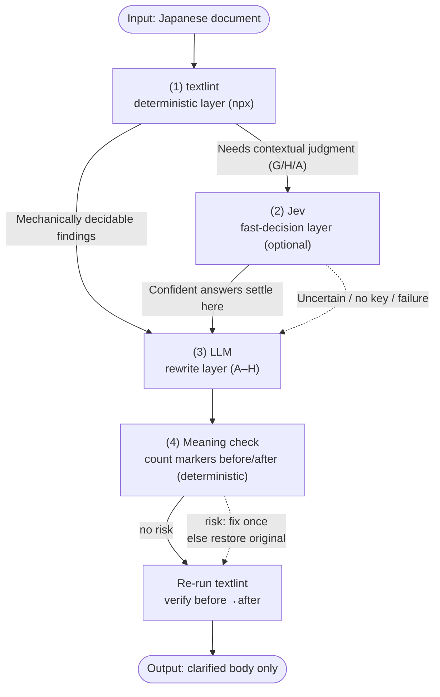

# meiseki

**An Agent Skill that strips high-reading-load syntax out of AI-written Japanese documents and rewrites them into prose you can understand in a single pass.**

`meiseki`（明晰）= "lucid; clear and understandable." The one and only goal is **clarity — a reader with no prior context can read the text once and understand it correctly.**
It never adds voice, stance, or personality to the text. It runs in the **opposite direction** from `stop-ai-slop-jp`-style tools, which inject subjectivity by rewriting generic statements into first-person opinions — meiseki adds no voice and aims for neutral clarity.

> For the background and motivation, see the author's article (Japanese):
> [AIの日本語を「自然」ではなく「明晰」にする ― meiseki という明晰化プラグインを作った話](https://zenn.dev/bamboo_nova/articles/c782c9de31e24b) (Zenn).

日本語版 README は [README.md](./README.md) を参照してください。

## Table of contents

- [Bundled skills](#bundled-skills)
- [Requirements](#requirements)
- [Installation](#installation)
- [Clarity skill meiseki:meiseki](#clarity-skill-meisekimeiseki)
- [Plain Japanese skill meiseki:yorisoi (since v0.6.0)](#plain-japanese-skill-meisekiyorisoi-since-v060)
- [Reading-comprehension check skill meiseki:rikai (since v0.8.0)](#readingcomprehension-check-skill-meisekirikai-since-v080)
- [PDF conversion skill meiseki:jp-pdf (since v0.8.0)](#pdf-conversion-skill-meisekijppdf-since-v080)
- [Auto-apply hook (when used as a plugin)](#autoapply-hook-when-used-as-a-plugin)
- [Directory layout](#directory-layout)
- [References](#references)
- [Disclaimer](#disclaimer)
- [Acknowledgments](#acknowledgments)
- [License](#license)

## Bundled skills

| Skill | What it does |
|---|---|
| 📝 **meiseki** | Strips high-reading-load syntax out of AI-written Japanese and rewrites it into prose you understand in one pass, without changing voice or meaning |
| 🤝 **yorisoi** | Rewrites text into Plain Japanese following the Immigration Services Agency guideline, with machine-checked vocabulary levels and a document-level N estimate |
| ✅ **rikai** | Builds comprehension quizzes from a document; wrong answers return later from a different angle, and explanations accumulate in study notes and PDF |
| 📄 **jp-pdf** | Converts Japanese Markdown into styled offline PDFs (also used for rikai's study notes) |

## Requirements

- Node.js installed
- For `rikai`: Python 3.8 or later (to serve the form). To also build the textbook PDF, xelatex (optional; see the `rikai` section for installation)

## Installation

### As an Agent Skill

Run the following in an environment with Node.js installed.

```
npx skills add https://github.com/bamboo-nova/meiseki --skill meiseki
```

### As a Claude Code plugin (optional)

`claude plugin install` takes **a plugin name registered in a marketplace** (not a path).
So `claude plugin install ./meiseki` and `claude plugin install .` fail. The correct way is to
first register the bundled `.claude-plugin/marketplace.json` as a marketplace, then install by name.

```bash
# 1. Register this plugin's marketplace (.claude-plugin/marketplace.json)
claude plugin marketplace add ./meiseki

# 2. Install as "plugin-name@marketplace-name"
claude plugin install meiseki@bamboo-nova-ja-tools
```

If you just want to load it temporarily during development without installing:

```bash
claude --plugin-dir ./meiseki
```

> You can validate the manifest with `claude plugin validate ./meiseki`.

### As a Codex CLI plugin (since v0.5.0)

Codex CLI (verified on the 0.149 series) supports the Agent Skills standard and a plugin mechanism, and can load meiseki as is.

```bash
# 1. Register this repository as a marketplace (Codex can read the Claude marketplace.json too)
codex plugin marketplace add ./meiseki

# 2. Install (the version is resolved from .codex-plugin/plugin.json)
codex plugin add meiseki@bamboo-nova-ja-tools
```

The meiseki skill (`meiseki:meiseki`) is now available from Codex.
The auto-apply hook (`hooks/codex-hooks.json`) is bundled as well, but Codex hooks
**require an explicit one-time trust grant for security reasons**. Run `/hooks` in an
interactive Codex session and trust the meiseki hook to enable it.

- Alternative without the plugin: copy `.agents/skills/meiseki/` into
  `~/.agents/skills/` to use the skill in every project. For the hook, write the
  absolute path to `scripts/codex-hook.sh` into the project's `.codex/hooks.json`
  and the same check will run.
- If the Codex sandbox blocks network access, `npx` inside the hook cannot fetch
  packages and the check passes through silently (fail-open). Running
  `npm run lint -- <any md>` once beforehand warms the cache and makes it reliable.

### Updating an existing installation (replacing an older version)

When updating to v0.3.0 or later (which ships the hook), uninstall once and reinstall.

```bash
claude plugin uninstall meiseki
claude plugin marketplace update bamboo-nova-ja-tools
claude plugin install meiseki@bamboo-nova-ja-tools
```

Restart the session after updating to activate the new hook.

## Clarity skill `meiseki:meiseki`

The core skill the plugin is named after. It strips high-reading-load syntax out of AI-written Japanese and rewrites it into prose you can understand in a single pass.

### What it fixes

It targets **syntax** that is hard to parse even for native Japanese readers (the cause of hard-to-read text is syntax, not difficult vocabulary).

- Double negatives (litotes) / nested negation and conditionals
- Long pre-nominal modifiers / long subject–predicate distance / overloaded single sentences
- Chains of the particle「の」/ excessive nominalization and Sino-Japanese compounds
- Redundant or empty expressions (e.g.「することができます」)
- Excessive formatting such as overused bold-plus-colon bullet lists
- Three or more coordinate items buried in one sentence (unfolded into a bullet list)
- LLM boilerplate phrases (「重要なのは〜」,「掘り下げる」,「多角的」,「〜に他ならない」, etc. — machine-detected with the bundled prh dictionary)
- AI-flavored formatting and hype words (emoji bullet lists, bold-plus-colon list boilerplate,「革命的」("revolutionary"),「ゲームチェンジャー」("game changer"), etc. — machine-detected with `textlint-rule-preset-ai-writing`)
- Paragraph-level redundancy (repeated restatements of the same claim, re-summarizing right after a description, parallel facts scattered across paragraphs)

**In scope**: technical articles, READMEs, design documents, internal documentation, explanatory blog prose.
**Out of scope**: code itself, short social-media posts, creative writing such as fiction and poetry, and precision-critical legal / medical / academic texts.

### Architecture (three layers; the Jev layer is optional, since v0.9.0)



Layer roles: (1) detects double negatives, sentence length, redundancy, and LLM boilerplate with line/column info and produces RLS (before). (2) bundles the findings that need contextual judgment (G boilerplate substance / H paragraph repetition / A litotes) into one request and answers them instantly as yes/no probabilities. (3) handles the remaining judgments plus the rewrite itself. (4) counts markers such as numbers, negations, conditions, and certainty before and after the rewrite, and finds paragraphs whose meaning may have changed (see [Meaning check](#meaning-check-since-v0110) below).

- **Detection and scoring belong to textlint (deterministic layer)**; **rewriting belongs to the LLM layer** — unchanged since the first release.
- The v0.9.0 Jev layer takes over **only the contextual judgments** the LLM used to spend time on.
  Without a key, layer (2) is skipped entirely and the plugin behaves exactly like the original two layers.
  For measured speed (roughly 70x) and adoption criteria, see [Jev fast-decision layer](#jev-fast-decision-layer-since-v090) below.
- No MCP server. textlint runs via `npx`; Jev is called through the bundled `scripts/jev-judge.js`.
- Full plugin structure maps (component inventory and execution flow) live in `docs/diagrams/`.

### Usage

Just hand the target Japanese text to the skill. Example triggers (in Japanese):

- 「この README を読みやすく直して」("Make this README easier to read")
- 「この説明文、AIっぽいので明晰化して」("This description sounds AI-written — clarify it")
- 「冗長な日本語を削って一読で分かるようにして」("Trim the redundant Japanese so it's clear in one pass")

By default only the **rewritten body text** is returned. Say「どこを直したか教えて」("tell me what you changed") to get the list of changes as well.
Say「スコアも出して」("show the score too") to include the reading-load score (before→after).

### Markdown-syntax and mojibake checks (since v0.7.0)

Since v0.7.0, Markdown documents also get a syntax check via markdownlint (run via `npx`).
Both the before and after versions are linted, so the rewrite is mechanically guaranteed not to
break Markdown syntax (list markers, blank lines, headings, etc.) — a regression guard.
Pre-existing violations are not fixed; they are only reported at the end. If `npx` is unavailable,
the check is skipped (fail-open, same as textlint). The rule set lives in
`references/markdownlint.config.jsonc`.
Manual run: `npm run lint:md -- <md>`.

Also since v0.7.0, mojibake is detected (category I: NFD-decomposed kana, control characters,
zero-width spaces, garbled half-width katakana, U+FFFD). These are reported instead of rewritten, and the user decides how
to handle them — control characters can be intentional, and U+FFFD marks a character whose
original is lost, so guessing a replacement would fabricate meaning.

### Meaning check (since v0.11.0)

A bundled script mechanically compares the text before and after the rewrite to confirm that nothing that must stay the same has changed. Having the rewriting LLM re-read its own output gives no way to notice what it missed. The most serious failure is flipping the logic when folding a double negative (`「影響がないとは言えません」` "it cannot be said there is no impact" → `「影響しません」` "there is no impact").

| Compared | Flagged as a risk when |
|---|---|
| Protected regions (code, quotes, math, URLs) | even one character changes |
| Numbers, identifiers (API and function names), terms in 「」 | they disappear from the whole document, or ones absent from the original appear |
| Number of negations | the change within a paragraph is odd (folding a double negative correctly removes them in pairs, so an even decrease is treated as a fold) |
| Condition / exception / limitation markers (`場合`, `ただし`, `のみ`, …) | they decrease within a paragraph |
| Certainty / obligation / universal / partial markers (`ことがある`, `べき`, `常に`, `一部`, …) | they decrease within a paragraph (e.g. a hedge `ことがある` turned into an assertion `する`) |

- Markers are counted by class, so paraphrases and inflections collapse together: `ことがある`, `こともある`, and `場合がある` each count as one "possibility" marker
- Paragraphs are aligned by character overlap. meiseki splits and merges sentences and deletes paragraphs, so comparison is per paragraph, not per sentence
- For a flagged paragraph, the LLM makes one fix and the check runs again. If the risk remains, the script restores that paragraph to the original. This enforces the guardrail "leave text in its original form when it cannot be fixed without changing its meaning"
- The script only reports marker changes; it does not decide whether meaning was preserved. No findings does not mean a pass, so the LLM's own checks still follow
- Run time grows roughly linearly with length: about 0.1 s for 25,000 characters and about 0.9 s for 250,000 characters (measured on an Apple M1). At every size it stays under 5% of one textlint run, so the overall rewrite speed barely changes. The method and raw data are in `experiments/meaning-benchmark/` (re-measure with `npm run bench:meaning`)
- No dependencies and no network, so it behaves the same on every host. Where `node` is unavailable, the mechanical check is skipped and only the LLM checks run (fail-open, like textlint)

To run it by hand (exit codes: 0 = no risk, 1 = risk, 2 = cannot judge, 3 = out of scope, i.e. no Japanese):

```bash
npm run check:meaning -- --before before.md --after after.md          # show findings
npm run check:meaning -- --before before.md --after after.md --json   # JSON output
npm run check:meaning -- --before before.md --after after.md --revert-risky --out final.md   # restore flagged paragraphs
npm run test:meaning   # tests: 10 meaning-preserving pairs, 7 kinds of meaning changes, and more (examples in examples/meaning/)
```

### Jev fast-decision layer (since v0.9.0)

Since v0.9.0, TypeSafe's Jev (a decision-only model that returns typed judgments) can serve as an optional fast-decision layer.
It activates only when an API key is configured; without one, behavior is exactly as before (fully optional).

**The measured effect is roughly a 70x speedup** (2026-10-11/12, jev-1.13.0): the 8 contextual judgments meiseki makes during a rewrite come back in about 250ms from Jev, versus 18 seconds from an LLM.

| Method | Time for 8 contextual judgments |
|---|---|
| **Jev, batched (production shape)** | **218-260ms** |
| Jev, one call per question | 2.0s total |
| LLM (claude -p, median) | 18.0s |

A batched Jev call costs about the same as a single question, which is why the skill sends all questions in one request.
On accuracy, adopting only confident answers (p >= 0.8 / p <= 0.2) produced **zero wrong adoptions** in the measurements; uncertain judgments still go to the LLM as before.

On 2026-10-12 we expanded the judgment set to 20 questions and re-measured. A single batched call still took 276-325ms (the LLM took 23-24 seconds — about 77x by medians), and adoption-band judgments were wrong 0 times out of 36 across 3 runs. The LLM side varies between 9 and 24 seconds day to day, so the honest reading of the gap is a 30-70x range. Raw data lives in `experiments/jev-benchmark/`.

It is used in two places: meiseki's pre-rewrite contextual judgments (the 8 questions in the table above), and yorisoi's document-level N1-N5 scoring in assessment mode. The yorisoi side is also measured: it ordered all 3 before/after pairs correctly at an average of 387ms per document (the same scoring via an LLM took a median of 20.7s — roughly 9x). That mode sends the near-full text, though, so it runs only on explicit request even with a key (the default is the jReadability band label).

- Four ways to configure the key; no special tooling is required, and the key file is the standard choice
  1. `npm run jev:setup` (standard, simplest): run it and paste the key. It is saved to `~/.config/meiseki/jev.key` (mode 0600, never echoed). **If you use 1Password, paste a secret reference (`op://Vault/Item/credential`) instead of the key**; only the retrieval command is saved to `~/.config/meiseki/jev.cmd`, and the key itself never touches disk (it is fetched from 1Password on every use)
  2. Claude Code settings (same style as MCP server keys): add `"TYPESAFE_API_KEY": "..."` to `"env"` in `~/.claude/settings.json`, and it propagates to the skill's execution environment
  3. Environment variable: set `TYPESAFE_API_KEY` in your shell (checked first; suited to CI)
  4. Key command: an optional style for secret-manager users (such as 1Password). Put `export TYPESAFE_JEV_KEY_CMD='op read "op://Private/TypeSafe Jev/credential"'` in your shell profile; only the retrieval command string is stored, and the key itself never touches disk
  - Results from key commands and `op://` references are cached for 1 hour in the OS secure store (macOS Keychain / Linux libsecret / Windows DPAPI), so 1Password asks for approval once per hour instead of per call. The cache is encrypted storage — no plaintext files — and expired entries are deleted the next time the Jev layer runs, regardless of how the key is resolved. Tune with `TYPESAFE_JEV_KEY_TTL` (seconds), disable with `0`, purge with `node scripts/jev-judge.js --clear-cache`. Environments without a secure store (headless Linux, etc.) skip caching and fetch every time
  - On plaintext: pasting the key directly ((1) with a raw key, (2), (3)) keeps it in plaintext inside user-owned config files (protected by permissions). To keep key material off disk entirely, use the `op://` reference in (1) or option (4)
  - From inside a Claude Code session, just ask "set up the Jev key" and the skill resolves the right command for you (including the install path when running as a marketplace plugin); with the `!` terminal prefix, the key is never echoed and never lands in the conversation log
  - If you installed via the marketplace (`claude plugin install`), you can set it up without cloning the repository:

    ```bash
    MEISEKI_DIR=$(ls -d ~/.claude/plugins/cache/bamboo-nova-ja-tools/meiseki/* | sort -V | tail -1)
    node "$MEISEKI_DIR/scripts/jev-judge.js" --setup
    ```

  - Keys are stored under `~/.config/meiseki/`, independent of where the plugin lives, so updating or reinstalling the plugin never loses your key setup
  - Whichever you choose, verify with `npm run jev:check`. Without a key, the Jev layer is skipped automatically and everything works as before
- The auto-apply hook never uses Jev (it stays fully offline)

On data transmission and privacy: enabling Jev sends the text under judgment to TypeSafe's servers. meiseki sends only excerpts of the flagged sentences/paragraphs plus the questions. yorisoi's document-level estimate would send the first 48,000 characters of the document (effectively the whole thing), so **it stays disabled by default even with a key configured** — the skill asks for your consent first and runs it only when you agree (ask-by-default opt-in). TypeSafe states it does not train on customer data, but **accounts are not ZDR (zero data retention) by default** — requests may be kept for some period for operations, abuse prevention, or debugging. Any organization can turn on ZDR for free: request it from TypeSafe support, then confirm it under Settings → Organization in the console (see [TypeSafe's ZDR article](https://help.typesafe.ai/articles/9520184411-do-you-offer-zdr)).

For documents that must not leave your machine, disable Jev with any of the following. Each is a complete fallback to the previous behavior; no functionality is lost.

- Put a `.meiseki-no-jev` file (empty is fine) at the project root. Ancestor directories are scanned, so this reliably stops transmission for the whole repository
- Write a per-scope policy in the project's `.meiseki.json`, e.g. `{"jev": {"meiseki": "ask", "yorisoi": "deny"}}`. `deny` always blocks; `ask` makes the skill confirm with you each time before running (defaults: meiseki=allow, yorisoi=ask). A ready-to-copy example, plus where the file is looked up, what each value means, and how to check the active policy, is in [`examples/config/`](examples/config/) (written in Japanese)
- Set the environment variable `MEISEKI_JEV_DISABLE=1` (per session / CI)
- Simply do not configure a key (the default state)
- The dataset, reproduction steps, and raw results behind these numbers live in `experiments/jev-benchmark/` (re-measure any time with `npm run bench:jev`)

On hosts other than Claude Code (Codex CLI, Devin, etc.) and in CI: key configuration (key file, environment variable, key command), the `.meiseki.json` policy, and the `.meiseki-no-jev` marker are all read directly by the bundled Node scripts, so **they work identically on every host**. Only the `ask` confirmation depends on the host's interaction facility — AskUserQuestion on Claude Code, `request_user_input` or a text question on Codex. Where no confirmation is possible (CI, autonomous runs), `ask` can never receive consent and therefore **behaves like deny** (fails safe).

### Rule rationale for `references/textlint.config.json` (the key differentiator)

The full presets also enforce rules **unrelated to reading load** — orthographic variants, exclamation marks, katakana long vowels — and "over-polish" the text.
meiseki keeps **only the rules that affect reading load** and turns everything else off with `false`.

| Enabled (true) | Role |
|---|---|
| `no-double-negative-ja` | Double negatives (top-priority category A) |
| `sentence-length` (max 90) | Sentence length (B) |
| `max-ten` (max 3) | Excessive commas (B) |
| `max-kanji-continuous-len` (max 6) | Long kanji runs = heavy Sino-Japanese compounds (C) |
| `ja-no-redundant-expression` | Redundant expressions such as「することができる」(C/D) |
| `no-doubled-joshi` (min_interval 1) | Repeated particles (B) |
| `no-doubled-conjunction` | Repeated conjunctions (D) |
| `no-doubled-conjunctive-particle-ga` | Consecutive adversative「が」= a sign of overloading (B) |
| `ja-no-weak-phrase` | Weak phrases (D — never used to strengthen a stance) |
| `prh` (bundled dictionary `prh-llm-phrases.yml`) | LLM boilerplate (G). **Detection only** — the LLM decides in context whether to cut or keep. Also detects, via the A1 supplement section, separated / polite-form double negatives that `no-double-negative-ja` misses (e.g.「〜ないとは言えません」) |
| `preset-ai-writing/no-ai-list-formatting` | Emoji bullets, bold-plus-colon list boilerplate (E) |
| `preset-ai-writing/no-ai-emphasis-patterns` | Excessive bold inside lists (E) |
| `preset-ai-writing/no-ai-hype-expressions` | Hype words such as「革命的」(G). Detection only, like prh; the LLM judges context |
| `preset-ai-writing/ai-tech-writing-guideline` | Conciseness findings such as redundant auxiliaries and vague phrasing (D). Enabled explicitly because its default severity is info |

Rules disabled (false):

- `arabic-kanji-numbers`, `no-mix-dearu-desumasu`, `ja-no-mixed-period`
- `no-dropping-the-ra`, `no-exclamation-question-mark`, `no-nfd`

> **Note on preset tracking**: changing the pinned versions of the `textlint` package or
> `textlint-rule-preset-ja-technical-writing` may change that preset's rule keys and defaults.
> When updating, check the preset's README for the rule list and verify the keys above still exist
> and match. If new bundled rules unrelated to reading load appear, turn them off with `false` likewise.

### Reading Load Score (RLS)

```
RLS = Σ(findings per category × weight) ÷ number of sentences in the body × 100   (lower is easier to read)
```

| Category | textlint rules | Weight |
|---|---|---|
| A Nested negation (top priority) | `no-double-negative-ja` | 3 |
| B Distance / length | `sentence-length`, `max-ten`, `no-doubled-conjunctive-particle-ga` | 2 |
| C Sino-Japanese compounds / nominalization | `max-kanji-continuous-len`, `ja-no-redundant-expression` | 2 |
| D Redundant / empty | `ja-no-redundant-expression`, `no-doubled-conjunction`, `ja-no-weak-phrase`, `ai-tech-writing-guideline` | 1 |
| E Formatting | `no-ai-list-formatting`, `no-ai-emphasis-patterns` (+ LLM judgment) | 1 |
| F Structuring (enumeration) | (LLM judgment) | 1 |
| G Boilerplate | `prh` (bundled dictionary), `no-ai-hype-expressions` | 1 |
| H Paragraph redundancy | (LLM judgment) | 1 |

**Acceptance criteria: after < before is mandatory; category A (double negatives) must in principle be 0.** Intentional litotes is the only exception.

### Acceptance checklist

- [ ] Output is body text only (no analysis, headings, or commentary attached)
- [ ] Opening generalities (「近年〜」"In recent years...") are removed
- [ ] 「することができます」has become「できます」
- [ ] 「〜の〜の〜」chains are untangled
- [ ] Long pre-nominal modifiers are split; subject and predicate are close together
- [ ] **Double negatives are folded without flipping the logic** (e.g.「招かないとは言えません」→「負荷が増えることがある」"the load can increase";「増えない」"does not increase" is a mistranslation = fail)
- [ ] The polite/plain style (敬体／常体) is preserved
- [ ] API names, proper nouns, and numbers are unchanged
- [ ] Sentences that were already plain are not rewritten needlessly
- [ ] **No voice or stance has been injected** (no added first-person opinions like「自分は」, no added assertive emphasis)
- [ ] LLM boilerplate (「重要なのは〜」,「掘り下げる」, etc.) is removed (usages with real substance in context are kept)
- [ ] Paragraph-level restatements and re-summaries are removed (claims, examples, evidence, and exceptions are not lost)
- [ ] The meaning check leaves no risk (paragraphs that could not be fixed have been restored to the original)
- [ ] Re-running textlint shows the reading-load score is lower than before (category A is 0)

## Plain Japanese skill `meiseki:yorisoi` (since v0.6.0)

`yorisoi`（寄り添い）= "staying close to the reader." The rewrite meets readers at their own vocabulary level.

A second skill that rewrites documents into "yasashii nihongo" (plain Japanese) for foreign
residents and Japanese learners. It differs from meiseki in **target reader**: use meiseki to
polish prose for native readers, and yorisoi for readers still learning Japanese. Example triggers:

- 「このお知らせをやさしい日本語にして」("Rewrite this notice in plain Japanese")
- 「外国人にもわかるように書き直して」("Rewrite it so non-native readers understand")
- 「やさしい日本語かチェックして」("Just check it" — report-only mode, no rewriting)

It keeps the same two-layer architecture and adds an **official external norm** as its basis.

- Normative basis: the [Guidelines for Plain Japanese for Residency Support](https://www.moj.go.jp/isa/support/portal/plainjapanese_guideline.html)
  (Immigration Services Agency & Agency for Cultural Affairs, August 2020). Bans on double
  negatives, avoidance of passive and speculative phrasing, simplified honorifics, and notation
  rules (Western calendar years, AM/PM times, no "〜" ranges) are machine-detected by textlint
  plus a bundled prh dictionary (`prh-yorisoi.yml`)
- Vocabulary-level checking: a bundled script (`scripts/yorisoi-vocab-check.js`) tokenizes the
  text with kuromoji.js (auto-fetched on first run) and reports words above the target level with
  line positions. The default target is **roughly N4** (changeable, e.g. 「N3 で」)
- **Every "N-level" label is an estimate.** The official JLPT vocabulary lists have been
  unpublished since 2010, so the bundled lists (tanos.co.uk-derived, CC BY) and NINJAL's basic
  vocabulary survey data (CC BY 4.0) approximate them. If you obtain the JEV vocabulary list
  yourself and drop it in, it takes precedence (see `references/vocab/README.md`)
- Scoring: a "yasashisa load score" (YLS, same form as RLS) verifies before→after
- Important words that cannot be simplified are kept with an inline gloss in the guideline's
  format:「余震＜＝後から来る地震＞」("aftershock <= an earthquake that comes later>")
- **Not** wired into the auto-apply hook (on-demand only). Furigana and word spacing are out of
  scope as of v0.6.0

Development commands: `npm run lint:yorisoi -- <md>` (syntax detection) and
`npm run vocab:yorisoi -- <md>` (vocabulary check). Worked examples with measured scores live in
`examples/yorisoi/`.

## Reading-comprehension check skill `meiseki:rikai` (since v0.8.0)

`rikai`（理解）= "understanding; comprehension." It checks whether a document was understood, not just read.

`rikai` is the third skill. It asks multiple-choice questions drawn from a source document and checks whether the reader understands its claims, assumptions, and exceptions.

Example triggers:

- "Check my understanding of this document"
- "Quiz me on this document"
- "Continue reviewing from last time"

All questions are placed on a single-page form that opens in the browser. Answer every question, submit once, and a results table appears in the terminal. The default is 10 questions; ask for a different number if you like ("5 questions").

Questions and explanations are written in the language you ask in (ask in Japanese and you get Japanese; ask in English and you get English). Quotations from the source stay in the source's language. If a document already has explainers, new topics are added in their language; ask to switch and they are rewritten in the new one.

Answers are collected by the first available method:

1. Local server. A bundled script serves the form on `127.0.0.1` and receives the submission. In Claude Code the session resumes as soon as you submit
2. Pasted answer code. The form shows a code such as `1:b 2:a`, which you paste into the terminal
3. Plain text. Where no browser is available, all questions are shown as text

Topics you got wrong last time are included first when the next quiz is assembled. Questions appear in random order, and the results table tells you which ones were review questions. A topic is never asked twice in the same session.

Only topics you got wrong are reviewed. A topic answered correctly with no prior mistake graduates immediately and is not asked again.

Under the **three-attempt rule**, a topic you once got wrong graduates after three correct answers in total. A later mistake does not reset the count.

Explanations accumulate in two explainers with different roles. Each source document has one pair, and the topics you attempt are added after every session.

| File | Role |
|---|---|
| `report.explainer.html` | Picture notebook. Builds intuition with large pictures and one-line analogies. A standalone file that makes no network requests |
| `report.explainer.pdf` | Textbook. Works through definitions, formulas, and worked examples. Typeset with LaTeX; the manuscript is `report.explainer.tex` |

Learning history is saved in a `study.md` file inside a `.rikai/` folder next to the source document. The explainers live in the same folder.

When the source name ends in `.md`, that extension is replaced with `.study.md`.

Otherwise `.study.md` is appended to the original name, for example `report.pdf.study.md`.

The body of `study.md` holds a writer feedback report that aggregates the passages most often misread.

The writer can revise those passages with `meiseki`, then run `rikai` again to close the feedback loop.

### Progress dashboard and manual graduation (since v0.10.0)

`.rikai/dashboard.html` gathers the progress of every document in that folder on one page: the share of each status per document, what comes up for review next, the most misread passages (the same aggregation as the writer feedback report), a collapsible attempt history per topic, and links to the explainers. It is rebuilt after every session, and "show me my progress" rebuilds it without a quiz. It is a standalone static HTML file that makes no network requests, and the same `study.md` files always produce the same page.

A topic you have mastered outside `rikai` (through exercises, say) can be graduated by asking "mark this topic as reviewed". Nothing is added to the attempt history; the topic gets a `manual_graduation` record (time and reason) in `study.md`. The dashboard and explainers show it as "Mastered (manual)", and "put it back under review" undoes it. The dashboard only reads; `rikai` is the only thing that writes `study.md`.

Serving the form requires Python 3.

The textbook PDF is optional and needs xelatex. Without it, quizzes, grading, and the picture notebook still work. The manuscript (`.tex`) is extended every session, so once you install xelatex the next build produces a PDF covering every topic so far. `rikai` never installs it for you.

| OS | How to install |
|---|---|
| macOS | `brew install --cask mactex-no-gui`, or [MacTeX](https://www.tug.org/mactex/) |
| Debian / Ubuntu | `sudo apt install texlive-xetex texlive-lang-japanese texlive-latex-extra texlive-pictures` |
| Other Linux | [TeX Live](https://www.tug.org/texlive/) |
| Windows | `install-tl-windows.exe` from [TeX Live](https://www.tug.org/texlive/windows.html) |

IPAexGothic is the preferred Japanese font; if it is missing, a font already on the system is used (Hiragino Sans, Yu Gothic, or Noto Sans CJK JP).

`rikai` is excluded from the auto-apply hook and runs only on request.

See `examples/rikai/` for a source document, learning history, explainers, writer feedback report, and reproduction steps.

## PDF conversion skill `meiseki:jp-pdf` (since v0.8.0)

The fourth skill: converts Japanese Markdown into styled offline PDFs. The pipeline is pandoc → xelatex only — no Chrome, no external services. rikai's textbook output also goes through this skill.

- Trigger examples: "turn this Markdown into a PDF", "generate a Japanese PDF"
- Prefers IPAexGothic and supports embedded SVG figures, colored headings, callout quotes, and striped tables
- See `.agents/skills/jp-pdf/SKILL.md` for prerequisites (pandoc, xelatex, librsvg) and detailed usage

## Auto-apply hook (when used as a plugin)

When enabled as a plugin, **a check runs automatically every time Claude Writes / Edits a Japanese Markdown file**.
The hook itself never calls an LLM. It runs only textlint (the deterministic layer), and when
the reading load is high it feeds back to Claude: "apply the meiseki skill and rewrite."
Claude then applies meiseki within the same session and rewrites the file.

```
Claude Writes / Edits report.md
        │
        ▼
[PostToolUse hook] scripts/meiseki-check.sh (the check core is scripts/meiseki-lint-core.sh)
  ├─ Out of scope (non-.md / excluded path / no Japanese / opt-out) → do nothing
  ├─ Re-run guard (content hash) → already judged / limit reached → exit without linting
  ├─ Mask out-of-scope regions (code, math, quotes, references, figure/table captions)
  ├─ Run textlint → no findings / minor → do nothing
  └─ Double negative present or 3+ findings
       → decision:"block" + finding summary fed back to Claude
       → Claude applies meiseki and re-Writes (until textlint passes)
```

- **Trigger condition**: at least one `no-double-negative-ja` finding (category A), or 3+ textlint findings in total.
  Separated / polite-form double negatives (caught by the prh supplement dictionary) count toward the total as ordinary prh findings.
  Note that the acceptance criterion in SKILL.md §7 is the **relative comparison** "after < before" with no absolute threshold;
  this trigger condition is therefore a simplified hook-side criterion (see the top of `scripts/meiseki-check.sh`).
- **Masking of out-of-scope regions**: the out-of-scope declaration in SKILL.md §3 is also implemented on the hook side.
  Code fences (including mermaid), math (`$...$` / `$$...$$` / `\begin{...}`), quote blocks,
  figure/table caption lines (`図1:` / `Table 1.` etc.), reference sections (from a heading like
  `## 参考文献` / `## References` to the next heading — **the whole section is masked, so it does not
  depend on the entry format: Nature / ASA / APA / IEEE / Japanese styles all work**), inline IEEE-style
  `[1] ...` lines, and footnote definitions `[^1]:` are replaced with blank lines before linting and do
  not affect the judgment. This addresses false positives on references, math, and captions in academic documents.
- **Tests**: `npm run test:hook` (= `scripts/test-meiseki-check.sh`) is provided.
  It automatically tests the supplement dictionary's detection coverage and the hook's judgment, exclusions, masking, opt-out, and loop prevention.
- **Exclusions**: `CLAUDE.md` / `AGENTS.md` / `MEMORY.md` / `SKILL.md` / `*.study.md`; anything under `.claude/`, `plans/`, `memory/`,
  `node_modules/`, `.git/`, `scratchpad/`, `/tmp`; anything under `examples/` or `references/`;
  files containing no Japanese.
- **Loop prevention**: at most 2 blocks per file per session; after that, warnings only (changed content is still re-checked, and the warning reports the current result)
  (to stay consistent with the guardrail that prh findings are "not confirmed deletions").
  Judgments are recorded in a state file keyed by content hash (`$TMPDIR/meiseki-hook-state.tsv`);
  re-writing identical content replays the previous judgment without running textlint.
  Even in a different session (e.g. after a restart), content already blocked gets a warning only and is not re-blocked.
- **Fail-open**: in environments where textlint cannot run (offline, etc.), writes are never blocked.
- **Mojibake check (since v0.7.0)**: NFD-decomposed kana, invalid control characters,
  zero-width spaces, garbled half-width katakana (e.g. "ﾃｺﾞｺﾞﾆ", a common LLM output glitch),
  and U+FFFD (�) trigger a warning (additionalContext) instead of a block,
  asking the user how to proceed — a rewrite cannot fix these, and control characters or
  half-width kana are sometimes intentional. Files that are not valid UTF-8 (e.g. Shift_JIS) get the same warning.
  None of these count toward RLS or the block threshold.
- **Disabling**: set the environment variable `MEISEKI_HOOK_DISABLE=1`, or disable the plugin itself.
  Per file, add `meiseki: skip` to the frontmatter or write `<!-- meiseki-disable -->` anywhere in
  the body to exclude just that file.
- **About PDFs**: a PDF cannot be fixed after generation, so this hook guarantees clarity at the
  source-Markdown stage (PDF generation via pandoc etc. starts from already-clarified md).

> Hook additions and changes take effect after a session restart (or plugin reload).
> The first `npx` run may take tens of seconds to fetch packages (cached afterwards).
> If installed only as an Agent Skill (`npx skills add`), no hook is attached; the skill
> fires only when you ask, as before.

## Directory layout

```
meiseki/
├── .claude-plugin/          # Claude Code plugin manifest
├── .codex-plugin/           # Codex CLI plugin manifest
├── hooks/
│   ├── hooks.json           # PostToolUse hook definition for Claude Code
│   └── codex-hooks.json     # PostToolUse hook definition for Codex CLI
├── scripts/
│   ├── meiseki-lint-core.sh     # Deterministic-layer core: masking + textlint + threshold check (rule set swappable via env vars)
│   ├── meiseki-check.sh         # Claude Code adapter: JSON I/O and re-run guard
│   ├── codex-hook.sh            # Codex adapter: extracts paths from the apply_patch envelope and bridges
│   ├── yorisoi-vocab-check.js  # Wrapper for the vocabulary-level checker (core ships inside the skill)
│   ├── jev-judge.js             # Jev decision client (key resolution, fallback, --setup/--check)
│   ├── meiseki-invariants.js    # Meaning-check wrapper (body ships with the skill; npm run check:meaning)
│   ├── test-meaning.js          # Automated tests for the meaning check (npm run test:meaning)
│   ├── bench-meaning.js         # Meaning-check run-time benchmark (npm run bench:meaning)
│   ├── bench-jev.js             # Jev speed/agreement benchmark (npm run bench:jev)
│   ├── test-meiseki-check.sh    # Automated tests for the hook, prh dictionary, and Jev fallback (npm run test:hook)
│   └── test-yorisoi.sh         # Automated tests for yorisoi detection and vocabulary checks (npm run test:yorisoi)
├── .agents/skills/          # Standard Agent Skills location (shared by Claude Code and Codex)
│   ├── meiseki/
│   │   ├── SKILL.md         # LLM orchestrator for the clarity skill
│   │   ├── scripts/meiseki-invariants.js # Meaning check (compares markers before/after, restores originals; no dependencies)
│   │   └── references/
│   │       ├── patterns.md             # High-load syntax catalog A–H
│   │       ├── prh-llm-phrases.yml     # Detection dictionary for LLM boilerplate (category G, detection only)
│   │       ├── textlint.config.json    # textlint config narrowed to rules that affect reading load
│   │       └── markdownlint.config.jsonc # Minimal rule set for the Markdown-syntax regression guard
│   ├── yorisoi/
│   │   ├── SKILL.md         # LLM orchestrator for the plain-Japanese skill
│   │   ├── scripts/vocab-check.js      # Vocabulary-level checker (morphological analysis + bundled lists)
│   │   └── references/
│   │       ├── patterns-yorisoi.md    # Guideline-derived rewrite catalog YA–YH
│   │       ├── prh-yorisoi.yml        # Detection dictionary: passive, speculation, honorifics, notation
│   │       ├── textlint-yorisoi.config.json
│   │       └── vocab/                  # Vocabulary lists (sources and licenses in its README)
│   ├── rikai/
│   │   ├── SKILL.md         # LLM orchestrator for the comprehension-check skill
│   │   ├── references/
│   │   │   ├── question-design.md     # Rules for multiple-choice and fresh-angle review questions
│   │   │   ├── study-format.md        # Storage format for learning history and the writer feedback report
│   │   │   ├── quiz-format.md         # Format of quiz data, answers, and answer codes
│   │   │   ├── explainer-html.md      # How to write the picture notebook
│   │   │   └── explainer-textbook.md  # How to write the textbook
│   │   ├── assets/          # Templates for the quiz form and picture notebook, LaTeX style for the textbook
│   │   └── scripts/         # build_quiz.py / quiz_server.py / build_textbook.py (Python standard library only)
│   └── jp-pdf/              # Japanese Markdown -> styled PDF (pandoc/xelatex)
│       ├── SKILL.md
│       ├── scripts/         # build_pdf.py / svglib.py
│       └── assets/style.tex
├── experiments/
│   ├── jev-benchmark/           # Jev benchmark dataset, reproduction steps, and raw measurements
│   └── meaning-benchmark/       # Meaning-check run-time method and raw measurements
├── examples/
│   ├── meiseki/             # Clarity examples (9 before/after pairs + measured RLS)
│   ├── yorisoi/            # Plain-Japanese examples (3 before/after pairs + measured YLS)
│   ├── rikai/              # Example source, learning history, and explainers (picture notebook and textbook)
│   ├── meaning/             # Meaning-check examples (7 kinds of meaning changes, a safe rewrite, restoring originals)
│   ├── config/              # Example .meiseki.json (policy for sending text to Jev) with notes
│   └── markdownlint/        # Markdown-syntax check examples (samples firing all 13 rules)
├── package.json             # Provides npm run lint / lint:yorisoi / lint:md / vocab:yorisoi / test:* for development
└── README.md
```

## References

The design of G (LLM boilerplate) and H (paragraph redundancy) draws on
k16shikano's [日本語技術文書の文章規範](https://gist.github.com/k16shikano/fd287c3133457c4fd8f5601d34aa817d)
(the japanese-tech-writing skill), in particular its sections on banning LLM-ish empty phrases,
eliminating redundancy, and structuring paragraphs and argumentation.

The yorisoi skill draws on the following resources:

- [Guidelines for Plain Japanese for Residency Support](https://www.moj.go.jp/isa/support/portal/plainjapanese_guideline.html) (August 2020) — the basis for the rewrite rules
- [tanos.co.uk JLPT vocabulary lists](http://www.tanos.co.uk/jlpt/) (CC BY, unofficial estimates)
- [NINJAL basic vocabulary survey data](https://mmsrv.ninjal.ac.jp/bvjsl84/) (CC BY 4.0)
- [JEV vocabulary list](https://jhlee.sakura.ne.jp/JEV/) (redistribution prohibited; optional, user-supplied)
- [jReadability](https://jreadability.net/) — the published formula behind the supplementary readability estimate

## Disclaimer

- This Agent Skill and plugin are provided "AS IS", **without any warranty** as to the accuracy, completeness, or fitness for a particular purpose of their output.
- Because meiseki **rewrites** text, the clarification process may alter the original meaning, nuance, or factual content. **Always review and verify the output yourself before using it.** Final responsibility for the content rests with the user.
- Documents requiring strict precision — legal, medical, contractual, academic — are **out of scope** (see "What it fixes"). The author accepts no responsibility for outcomes arising from such uses.
- The yorisoi skill's vocabulary-level labels ("roughly N4" etc.) are **estimates based on unofficial lists** and do not match any official JLPT standard.
- The yorisoi skill follows the official guidelines but is **not an approved or certified tool**. Simplification can alter meaning. Before publishing rewritten output as official information (administrative procedures, disaster notices, etc.), **have it reviewed by qualified staff** (Japanese-language education or multicultural affairs officers).
- The author and rights holders accept no liability for any direct or indirect damages arising from the use of, or inability to use, this Agent Skill and plugin (see `LICENSE` for details).
- Enabling the optional Jev fast-decision layer (since v0.9.0) transmits the text under judgment to TypeSafe's servers (excerpts of flagged passages for meiseki; for yorisoi's document-level estimate, the first 48,000 characters — and that path runs only on explicit request). TypeSafe states it does not train on customer data, but accounts are not ZDR by default and requests may be retained for operational purposes (ZDR can be turned on for free on request). **For documents containing confidential information, disable Jev (e.g. with a `.meiseki-no-jev` marker) before use.** Handling of transmitted data is governed by TypeSafe's terms; the author accepts no responsibility for it.
- This Agent Skill and plugin depend on third-party OSS such as textlint. The behavior and security of those dependencies are governed by their respective providers' terms and licenses.

## Acknowledgments

- Machine detection for E (formatting), G (hype words), and D (conciseness) uses [textlint-rule-preset-ai-writing](https://github.com/textlint-ja/textlint-rule-preset-ai-writing) (textlint-ja, MIT License).
- Thanks also to the authors and communities of [textlint](https://github.com/textlint/textlint) itself, [textlint-rule-preset-ja-technical-writing](https://github.com/textlint-ja/textlint-rule-preset-ja-technical-writing), [textlint-rule-prh](https://github.com/textlint-rule/textlint-rule-prh), and every other OSS dependency. Each package is governed by its own license.
- The yorisoi skill's vocabulary lists use Jonathan Waller's [tanos.co.uk JLPT lists](http://www.tanos.co.uk/jlpt/) (CC BY) via [jamsinclair/open-anki-jlpt-decks](https://github.com/jamsinclair/open-anki-jlpt-decks) and [elzup/jlpt-word-list](https://github.com/elzup/jlpt-word-list) (MIT), and NINJAL's [basic vocabulary survey data](https://mmsrv.ninjal.ac.jp/bvjsl84/) (CC BY 4.0).
- Morphological analysis for the vocabulary check uses [kuromoji.js](https://github.com/takuyaa/kuromoji.js) (Apache-2.0) and [kuromojin](https://github.com/azu/kuromojin) (MIT).

## License

MIT
