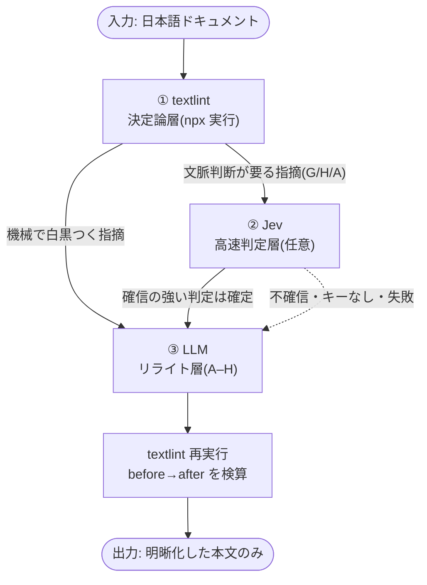

# meiseki

**AIが書いた日本語ドキュメントから読解負荷の高い構文を削ぎ落とし、一読で理解できる本文に書き直す Agent Skill。**

English version: [README.en.md](./README.en.md)

`meiseki`（明晰）＝澄んで分かること。目的は **明晰さ（clarity）= 内容を知らない読者が一度読んで正しく理解できること** だけ。
文章の声・立場・個性は足さない。一般論を「自分は」という意見に書き換えて主体性を注入する `stop-ai-slop-jp` 系とは
**逆方向**で、声を足さず中立な明晰さに振る。

> 開発の背景・モチベーションは作者の解説記事
> [AIの日本語を「自然」ではなく「明晰」にする ― meiseki という明晰化プラグインを作った話](https://zenn.dev/bamboo_nova/articles/c782c9de31e24b)（Zenn）を参照。

## 目次

- [収録スキル](#収録スキル)
- [必要環境](#必要環境)
- [インストール](#インストール)
- [明晰化スキル meiseki:meiseki](#明晰化スキル-meisekimeiseki)
- [やさしい日本語化スキル meiseki:yorisoi（v0.6.0 から）](#やさしい日本語化スキル-meisekiyorisoiv060-から)
- [読解度チェックスキル meiseki:rikai（v0.8.0 から）](#読解度チェックスキル-meisekirikaiv080-から)
- [PDF 変換スキル meiseki:jp-pdf（v0.8.0 から）](#pdf-変換スキル-meisekijppdfv080-から)
- [自動適用 hook（プラグイン利用時）](#自動適用-hookプラグイン利用時)
- [ディレクトリ構成](#ディレクトリ構成)
- [参考資料](#参考資料)
- [免責事項](#免責事項)
- [謝辞](#謝辞)
- [ライセンス](#ライセンス)

## 収録スキル

| スキル | 何をするか |
|---|---|
| 📝 **meiseki** | AI が書いた日本語から読解負荷の高い構文を削り、一読で分かる文章にする。声や意味は変えない |
| 🤝 **yorisoi** | 出入国在留管理庁のガイドラインに沿って「やさしい日本語」へ書き換える。語彙レベルと文書全体の N レベルも機械判定する |
| ✅ **rikai** | 資料から理解度クイズを作る。誤答は角度を変えて再出題し、解説は学習ノートと PDF に蓄積する |
| 📄 **jp-pdf** | 日本語 Markdown を配色付きのオフライン PDF に変換する（rikai の学習ノート出力にも使われる） |

## 必要環境

- Node.js がインストールされていること
- `rikai` を使う場合: Python 3.8 以上（フォームの配信）。テキストブックの PDF も作るなら xelatex（任意。導入方法は `rikai` の節）

## インストール

### Agent Skill として使う

Node.js がインストールされた環境で以下を実行。

```
npx skills add https://github.com/bamboo-nova/meiseki --skill meiseki
```

### Claude Code プラグインとして使う（任意）

`claude plugin install` は**マーケットプレイスに登録されたプラグイン名**を取る（パスは取らない）。
そのため `claude plugin install ./meiseki` や `claude plugin install .` は失敗する。正しくは、
まず同梱の `.claude-plugin/marketplace.json` をマーケットプレイスとして登録し、その名前で install する。

```bash
# 1. このプラグインのマーケットプレイス(.claude-plugin/marketplace.json)を登録
claude plugin marketplace add ./meiseki

# 2. 「プラグイン名@マーケットプレイス名」で install
claude plugin install meiseki@bamboo-nova-ja-tools
```

開発中にインストールせず一時的に読み込むだけなら、こちらが手軽：

```bash
claude --plugin-dir ./meiseki
```

> マニフェストの検証は `claude plugin validate ./meiseki` で行える。

### Codex CLI プラグインとして使う（v0.5.0 から）

Codex CLI（0.149 系で動作確認）は Agent Skills 標準とプラグイン機構を持ち、meiseki をそのまま読み込める。

```bash
# 1. このリポジトリをマーケットプレイスとして登録（Claude 用 marketplace.json を Codex も読める）
codex plugin marketplace add ./meiseki

# 2. install（バージョンは .codex-plugin/plugin.json から解決される）
codex plugin add meiseki@bamboo-nova-ja-tools
```

これで meiseki スキル（`meiseki:meiseki`）が Codex から使える。
自動適用フック（`hooks/codex-hooks.json`）も同梱されるが、Codex のフックは
**セキュリティ上、初回に明示的な信頼付与が必要**になっている。Codex の対話セッションで
`/hooks` を実行し、meiseki のフックを trust すると有効になる。

- プラグインを使わない場合の代替: スキルは `.agents/skills/meiseki/` を
  `~/.agents/skills/` にコピーすれば全プロジェクトで使える。フックはプロジェクトの
  `.codex/hooks.json` に `scripts/codex-hook.sh` への絶対パスを書けば同じ検査が走る。
- Codex のサンドボックスがネットワークを遮断していると、フック内の `npx` が
  パッケージを取得できず検査は素通しになる（フェイルオープン）。事前に一度
  `npm run lint -- <適当な md>` を実行してキャッシュを温めておくと確実に動く。

### 既存環境の更新（旧バージョンからの入れ替え）

hook 付きの v0.3.0 以降へ更新するときは、いったんアンインストールしてから入れ直す。

```bash
claude plugin uninstall meiseki
claude plugin marketplace update bamboo-nova-ja-tools
claude plugin install meiseki@bamboo-nova-ja-tools
```

更新後にセッションを再起動すると、新しい hook が有効になる。

## 明晰化スキル `meiseki:meiseki`

プラグイン名と同名の中核スキル。AI が書いた日本語から読解負荷の高い構文を削ぎ落とし、一読で理解できる本文に書き直す。

### 何を直すか

日本語ネイティブでも読解負荷の高い**構文**を対象にする（難しい語彙ではなく構文が読みにくさの原因）。

- 二重否定（litotes）/ 否定・条件の入れ子
- 長い連体修飾 / 主語‐述語の距離 / 一文への詰め込み
- 「の」の連鎖 / 過剰な名詞化・漢語
- 冗長・空虚な表現（`「することができます」` など）
- 太字＋コロンの箇条書き乱用などの過剰な体裁
- 一文に埋もれた 3 項目以上の同格列挙（箇条書きに開く）
- LLM 定型句（`「重要なのは〜」` `「掘り下げる」` `「多角的」` `「〜に他ならない」` など。同梱の prh 辞書で機械検出）
- AI 臭の強い体裁と誇張語（絵文字箇条書き・太字＋コロンのリスト定型・`「革命的」` `「ゲームチェンジャー」` など。
  `textlint-rule-preset-ai-writing` で機械検出）
- 段落レベルの冗長（同じ主張の言い換え反復・描写直後の再要約・並列事実の分散）

**対象**：技術記事・README・設計書・社内ドキュメント・ブログの説明文。
**対象外**：コード本体・SNS の短文・小説や詩などの創作・法務／医療／論文の厳密文。

### アーキテクチャ（三層構成。Jev 層は v0.9.0 から・任意）



各層の役割: ① は二重否定・一文長・冗長・LLM 定型句などを行/列つきで検出し、RLS(before)を出す。② は ① が「文脈判断が要る」とした指摘(G 定型句の実質 / H 段落反復 / A litotes)を 1 リクエストに束ね、確率つき yes/no で即答する。③ は残った判断とリライト本体を担う。

- **検出と採点は textlint（決定論層）**、**リライトは LLM 層**。この分担は初版から変わらない。
- v0.9.0 の Jev 層は、従来 LLM が時間をかけていた**文脈判断だけ**を肩代わりする。
  キーがなければ ② は丸ごとスキップされ、従来の二層とまったく同じに動く。
  速度の実測（約 70 倍）と採用条件は後述の[「Jev 高速判定層」](#jev-高速判定層v090-から)を参照。
- MCP サーバーは持たない。textlint は `npx`、Jev は同梱の `scripts/jev-judge.js` で呼ぶ。
- プラグイン全体の構成図（コンポーネントの棚卸しと実行フロー）は `docs/diagrams/` にある。

### 使い方

対象の日本語をスキルに渡すだけ。発動例：

- 「この README を読みやすく直して」
- 「この説明文、AIっぽいので明晰化して」
- 「冗長な日本語を削って一読で分かるようにして」

標準ではリライト後の**本文のみ**が返る。`「どこを直したか教えて」`と指定すると変更点も添える。
`「スコアも出して」`と指定すると読解負荷スコア(before→after)を併記する。

### Markdown 構文と文字化けの検査（v0.7.0 から）

v0.7.0 から、対象が Markdown 文書のときは markdownlint による構文検査が加わる（npx で都度実行）。
書き換えの前後両方を検査し、「リライトで Markdown 構文（リスト記号・空行・見出し等）を壊していない」
ことを機械的に保証する（リグレッションガード方式）。元からある違反は修正せず、末尾で報告だけ行う。
npx が使えない環境では検査をスキップする（フェイルオープン。textlint と同じ扱い）。
設定は `references/markdownlint.config.jsonc` で、手動実行は `npm run lint:md -- <md>`。

同じく v0.7.0 から文字化けも検出する（カテゴリ I。NFD 濁点分離・制御文字・ゼロ幅スペース・半角カナの化け・U+FFFD）。
これらはリライトせずに報告し、対応の要否をユーザーに確認する。
勝手に直さないのは、制御文字や半角カナには運用上意図的なケースがあるため。
U+FFFD は元の文字が失われていて推測復元が危険なため、正しい原文の提供を求める。

### Jev 高速判定層（v0.9.0 から）

v0.9.0 から、TypeSafe の Jev(型付き判定だけを返す decision-only モデル)を任意の高速判定層として使える。
API キーを設定した環境でだけ有効になり、未設定なら従来とまったく同じに動く(完全な任意機能)。

**効果は約 70 倍の高速化**(2026-10-11/12 実測・jev-1.13.0)。meiseki がリライト時に行う文脈判断 8 問を、LLM の 18 秒に対して Jev は約 250ms で返す。

| 方式 | 文脈判断 8 問の所要時間 |
|---|---|
| **Jev バッチ(実運用形)** | **218〜260ms** |
| Jev 単問 ×8 | 合計 2.0 秒 |
| LLM(claude -p・中央値) | 18.0 秒 |

Jev はバッチでも単問 1 回とほぼ同じ時間で返すため、「全問まとめて 1 回で投げる」設計が効いている。
精度面では、確信の強い判定(p ≥ 0.8 / p ≤ 0.2)だけを採用する運用で**採用判定の誤りは 0 件**だった(不確信な判定は従来どおり LLM が担う)。

2026-10-12 に判定セットを 20 問へ拡張して再測定した。一括判定は 276〜325ms と 8 問時から増えず(LLM は 23〜24 秒。中央値比で約 77 倍)、採用帯の判定は 3 回累計 36 問で誤り 0 だった。LLM 側の所要時間は日によって 9〜24 秒と振れるため、速度差は約 30〜70 倍のレンジで読むのが正確である。生データは `experiments/jev-benchmark/` を参照。

使われる場所は 2 つ。meiseki ではリライト前の文脈判断(上の表の 8 問がまさにこれ)、yorisoi の判定モードでは文書全体の N1〜N5 採点。yorisoi 側も実測済みで、before/after 6 文書の難易度順序を 3 ペアすべて正しく判定し、平均 387ms/文書だった(同じ採点を LLM で行うと中央値 20.7 秒。約 9 倍の差)。ただし後者は全文相当を送信するため、キーがあっても明示的に求めたときだけ動く(既定は jReadability 近似の帯ラベル)。

- キーの設定は 4 通りある。特別なツールは不要で、標準は (1) のキーファイル方式
  1. `npm run jev:setup`(標準・いちばん簡単): 実行してキーを貼り付けるだけ。`~/.config/meiseki/jev.key` に保存される(権限 0600・画面にエコーされない)。**1Password を使っているなら、キーの代わりに秘密参照(`op://Vault/Item/credential`)を貼る**。その場合は取得コマンドだけが `~/.config/meiseki/jev.cmd` に保存され、キー本体はディスクに残らない(実行のたびに 1Password から取得する)
  2. Claude Code の設定(MCP サーバーのキー設定と同じ要領): `~/.claude/settings.json` の `"env"` に `"TYPESAFE_API_KEY": "..."` を書くと、スキルの実行環境に自動で引き継がれる
  3. 環境変数: シェルで `TYPESAFE_API_KEY` を設定する(最優先で参照される。CI 向け)
  4. キーコマンド: 1Password 等の鍵管理ツールを使っている場合の任意の方式。シェルの設定ファイルに `export TYPESAFE_JEV_KEY_CMD='op read "op://Private/TypeSafe Jev/credential"'` と書く。設定に残るのは取得コマンドの文字列だけで、キー本体はどのファイルにも残らない
  - キーコマンドと `op://` 参照の取得結果は、OS のセキュアストア(macOS=キーチェーン / Linux=libsecret / Windows=DPAPI)に 1 時間キャッシュされる。これにより 1Password の承認プロンプトは 1 時間に 1 回で済む。キャッシュは暗号化保存で平文ファイルは作らず、期限切れのエントリは Jev 層の次回起動時に削除される(キーの解決経路に関係なく掃除される)。`TYPESAFE_JEV_KEY_TTL`(秒)で期間を変更、`0` で無効化、`node scripts/jev-judge.js --clear-cache` で即時削除できる。対応ストアがない環境(ヘッドレス Linux 等)ではキャッシュせず毎回取得する
  - 平文の扱い: キーを直接貼る方式((1) のキー貼り付け・(2)・(3))は、ユーザー領域の設定ファイルにキーが平文で残る(権限で保護)。キー本体をディスクに残したくない場合は、(1) の `op://` 参照か (4) を使う
  - Claude Code のセッション内からなら、「Jev のキーを設定したい」と頼むとスキルが実行コマンドを案内する(プラグインとしてインストールした場合も、設置先のパスをスキルが解決する)。`!` プレフィックスのターミナル実行なので、キー入力はエコーされず会話ログにも残らない
  - マーケットプレイス(`claude plugin install`)で導入した場合は、リポジトリを clone しなくても次の 2 行で設定できる

    ```bash
    MEISEKI_DIR=$(ls -d ~/.claude/plugins/cache/bamboo-nova-ja-tools/meiseki/* | sort -V | tail -1)
    node "$MEISEKI_DIR/scripts/jev-judge.js" --setup
    ```

  - キーの保存先は `~/.config/meiseki/` で、プラグインの設置場所と独立している。プラグインを更新・再インストールしてもキー設定はそのまま使える
  - どの方式でも、確認は `npm run jev:check`。キーがなければ Jev 層は自動でスキップされ、従来どおり動く
- 自動適用 hook では Jev を使わない(hook は従来どおりオフラインで完結する)

送信されるデータとプライバシーについて。Jev を使うと、判定対象のテキストが TypeSafe のサーバーへ送信される。meiseki が送るのは指摘対象の文・段落の抜粋と質問文だけ。yorisoi の文書レベル判定は文書の先頭 48,000 文字(実質ほぼ全文)を送るため、**キーが設定済みでも既定では実行されない**。スキルが AskUserQuestion で確認し、同意したときだけ動く(ask 既定のオプトイン)。TypeSafe は顧客データをモデルの学習に使わないと明言しているが、**標準アカウントは ZDR(ゼロデータ保持)ではなく**、運用・不正利用防止・デバッグ目的で一定期間保持されうる(ZDR はエンタープライズ契約のみ。詳細は [TypeSafe の法的文書](https://docs.typesafe.ai/legal)を参照)。

外部へ送信したくない文書を扱う場合は、次のいずれかで Jev を無効化できる。いずれも従来動作への完全なフォールバックで、機能は失われない。

- そのプロジェクトのルートに `.meiseki-no-jev` ファイルを置く(空で可)。作業ディレクトリの祖先も探索されるため、リポジトリ単位で確実に止まる
- プロジェクトの `.meiseki.json` でスコープ別のポリシーを書く。例: `{"jev": {"meiseki": "ask", "yorisoi": "deny"}}`。`deny` は常に拒否、`ask` はスキルがその都度ユーザーに確認してから実行する(既定: meiseki=allow、yorisoi=ask)
- 環境変数 `MEISEKI_JEV_DISABLE=1` を設定する(セッション・CI 単位)
- そもそもキーを設定しない(既定の状態)
- 上記の実測の対象データ・再現手順・生データは `experiments/jev-benchmark/` にある(`npm run bench:jev` で随時再計測できる)

Claude Code 以外のホスト(Codex CLI・Devin 等)や CI での利用について。キー設定(キーファイル・環境変数・キーコマンド)・`.meiseki.json` ポリシー・`.meiseki-no-jev` マーカーは、すべて同梱の Node スクリプトが直接読むため、**どのホストでも同じように機能する**。`ask` ポリシーの確認だけはホストの対話機能に依存し、Claude Code では AskUserQuestion、Codex では `request_user_input` またはテキスト問答で行われる。CI や自律実行のように確認手段がない環境では、`ask` は同意を得られないため **deny と同じ動作**になる(安全側に倒れる)。

### `references/textlint.config.json` のルール意図（差別化の肝）

フルプリセットは表記ゆれ・感嘆符・カタカナ長音など**読解負荷と無関係なルール**まで効いて「整えすぎ」になる。
meiseki は**読解負荷に効くルールだけ**を残し、それ以外を `false` で外している。

| 有効化（true） | 役割 |
|---|---|
| `no-double-negative-ja` | 二重否定（最優先カテゴリ A） |
| `sentence-length` (max 90) | 一文長（B） |
| `max-ten` (max 3) | 読点過多（B） |
| `max-kanji-continuous-len` (max 6) | 連続漢字＝漢語の重さ（C） |
| `ja-no-redundant-expression` | 冗長表現「することができる」等（C/D） |
| `no-doubled-joshi` (min_interval 1) | 助詞の重複（B） |
| `no-doubled-conjunction` | 接続詞の重複（D） |
| `no-doubled-conjunctive-particle-ga` | 逆接「が」の連続＝詰め込みの合図（B） |
| `ja-no-weak-phrase` | 弱い表現（D。※立場を強める方向には使わない） |
| `prh`（同梱辞書 `prh-llm-phrases.yml`） | LLM 定型句（G）。**検出専用**。削るか残すかは LLM が文脈判断する。加えて `no-double-negative-ja` が拾えない分離型・丁寧形の二重否定（`「〜ないとは言えません」` 等）を A1 補完セクションで検出する |
| `preset-ai-writing/no-ai-list-formatting` | 絵文字箇条書き・太字＋コロンのリスト定型（E） |
| `preset-ai-writing/no-ai-emphasis-patterns` | リスト内の過剰太字（E） |
| `preset-ai-writing/no-ai-hype-expressions` | 誇張語 `「革命的」` 等（G）。prh と同じく検出専用で、文脈判断は LLM が担う |
| `preset-ai-writing/ai-tech-writing-guideline` | 冗長助動詞・曖昧表現などの簡潔性指摘（D）。既定の severity が info のため明示的に有効化している |

無効化（false）にしたルール:

- `arabic-kanji-numbers`, `no-mix-dearu-desumasu`, `ja-no-mixed-period`
- `no-dropping-the-ra`, `no-exclamation-question-mark`, `no-nfd`

> **プリセット追従の注意**：`textlint` パッケージや `textlint-rule-preset-ja-technical-writing` パッケージの固定バージョンを変えると、
> `textlint-rule-preset-ja-technical-writing` のルールキーやデフォルト値も変わりうる。
> 変更時はプリセットの README でルール一覧を確認し、上記キーが存在するか・キー名が一致するかを点検すること。
> 読解負荷と無関係な同梱ルールが増えていたら、同様に `false` で外す。

### 読解負荷スコア（RLS）

```
RLS = Σ(カテゴリ件数 × 重み) ÷ 本文の文数 × 100   （低いほど読みやすい）
```

| カテゴリ | textlint ルール | 重み |
|---|---|---|
| A 否定の入れ子（最優先） | `no-double-negative-ja` | 3 |
| B 距離・長さ | `sentence-length`, `max-ten`, `no-doubled-conjunctive-particle-ga` | 2 |
| C 漢語・名詞化 | `max-kanji-continuous-len`, `ja-no-redundant-expression` | 2 |
| D 冗長・空虚 | `ja-no-redundant-expression`, `no-doubled-conjunction`, `ja-no-weak-phrase`, `ai-tech-writing-guideline` | 1 |
| E 体裁 | `no-ai-list-formatting`, `no-ai-emphasis-patterns`（＋LLM 判断） | 1 |
| F 構造化（列挙） | （LLM 判断） | 1 |
| G 定型句 | `prh`（同梱辞書）, `no-ai-hype-expressions` | 1 |
| H 段落冗長 | （LLM 判断） | 1 |

**受け入れ基準：after < before を必須、A（二重否定）は原則 0 件。** 意図的な litotes だけ例外。

### 受け入れ基準チェックリスト

- [ ] 出力は本文のみ（分析・見出し・講評が付いていない）
- [ ] 冒頭の一般論（「近年〜」）が削られている
- [ ] `「することができます」` → `「できます」` になっている
- [ ] 「〜の〜の〜」の連鎖がほどけている
- [ ] 長い連体修飾が分割され、主語‐述語が近い
- [ ] **二重否定が論理を反転させずに畳まれている**（例 `「招かないとは言えません」` → `「負荷が増えることがある」`。`「増えない」` は誤訳＝不合格）
- [ ] 敬体／常体が維持されている
- [ ] API 名・固有名詞・数値が変わっていない
- [ ] 元から平易な文を不要に作り替えていない
- [ ] **声・立場が注入されていない**（「自分は」等の意見や、言い切りの強調が足されていない）
- [ ] LLM 定型句（`「重要なのは〜」` `「掘り下げる」` 等）が削られている（文脈で実質を持つ用法は残っている）
- [ ] 段落レベルの言い換え反復・再要約が削られている（主張・例・根拠・例外は消えていない）
- [ ] textlint 再実行で読解負荷スコアが before より下がっている（A は 0 件）

## やさしい日本語化スキル `meiseki:yorisoi`（v0.6.0 から）

`yorisoi`（寄り添い）＝読み手の語彙のレベルに合わせて書くこと。

在留外国人や日本語学習者にも伝わる「やさしい日本語」への書き換えを行う第2のスキル。
明晰化（meiseki）とは**対象読者が違う**。日本語ネイティブ向けの推敲は meiseki、
日本語に不慣れな読者向けの書き換えは yorisoi を使う。発動例：

- 「このお知らせをやさしい日本語にして」
- 「外国人にもわかるように書き直して」
- 「やさしい日本語かチェックして」（書き換えず判定だけ行う）

設計は meiseki と同じ二層構成で、根拠に**公的な外部規範**を使う。

- 準拠する規範：[在留支援のためのやさしい日本語ガイドライン](https://www.moj.go.jp/isa/support/portal/plainjapanese_guideline.html)（2020年8月）。
  二重否定の禁止・受身や推測表現の回避・敬語の単純化・表記規則（西暦、
  午前/午後、「〜」の禁止）などを、textlint と同梱の prh 辞書（`prh-yorisoi.yml`）で機械検出する
- 語彙レベルの機械判定：同梱スクリプト（`scripts/yorisoi-vocab-check.js`）が
  形態素解析（kuromoji.js。初回のみ自動取得）で本文を分解し、同梱の語彙リストと照合して
  目標レベルを超える語を行位置つきで報告する。既定の目標は **N4 相当**（`「N3 で」`のように変更可）
- **「N○相当」はすべて推定値**。JLPT の公式語彙リストは2010年以降非公開のため、
  同梱リスト（tanos.co.uk 由来、CC BY）と国語研の基本語彙調査データ（CC BY 4.0）で近似している。
  語彙表 JEV を自分で入手して置くと、判定に最優先で使われる（`references/vocab/README.md` 参照）
- スコア：やさしさ負荷スコア（YLS。RLS と同型）で before→after を検算する
- 言い換えできない重要語は `「余震＜＝後から来る地震＞」` の形式で残して説明する（ガイドライン準拠）
- 自動適用 hook の**対象外**（オンデマンド専用）。ふりがな・分かち書きも v0.6.0 では対象外

開発用コマンド：`npm run lint:yorisoi -- <md>`（構文検出）、`npm run vocab:yorisoi -- <md>`（語彙判定）。
適用例と実測スコアは `examples/yorisoi/` にある。

## 読解度チェックスキル `meiseki:rikai`（v0.8.0 から）

`rikai`（理解）＝読んだ内容を正しく分かること。

`rikai` は資料から選択式の問題を出し、主張・前提・例外の理解を確かめる第3のスキル。

発動例：

- 「この資料の理解度を確認して」
- 「この資料でクイズして」
- 「前回の続きから内容を復習したい」

問題は全問を 1 ページのフォームにまとめ、ブラウザで開く。全問に答えて提出すると、採点結果の表がターミナルに出る。既定は 10 問で、「5 問で」のように数を指定できる。

問題と解説は、依頼に使った言語で書かれる（日本語で頼めば日本語、英語で頼めば英語）。原文の引用は資料の言語のままである。すでに解説（絵解きノートやテキストブック）がある資料では、その言語のまま書き足す。別の言語にしたいときは、そう頼めば全体を書き直す。

回答の受け取りは、その場で使える手段を次の順で選ぶ。

1. ローカルサーバ。同梱のスクリプトが `127.0.0.1` でフォームを配信し、提出を受け取る。Claude Code では、提出と同時にセッションが再開する
2. 回答コードの貼り付け。フォームが `1:b 2:a` 形式のコードを表示するので、ターミナルに貼る
3. テキスト。ブラウザを使えない環境では、全問をテキストで提示する

前回誤答した論点は、次の出題に優先して含める。出題の順番は無作為で、どれが復習問題だったかは採点結果の表で分かる。同じ論点は同一セッションで再出題しない。

復習の対象は誤答した論点だけとする。誤答なしで正解した論点は、その時点で卒業として再出題しない。

**三回挑戦法**では、誤答を経験した論点を通算 3 回の正解で卒業とする。途中の誤答で回数をリセットしない。

解説は、役割の違う 2 つの explainer に蓄積する。どちらも資料 1 つにつき 1 組で、挑戦した論点がセッションのたびに書き足される。

| ファイル | 役割 |
|---|---|
| `report.explainer.html` | 絵解きノート。大きな絵とひとことのたとえで直感をつかむ。単体で開け、外部通信をしない |
| `report.explainer.pdf` | テキストブック。定義・数式・例題で細部を詰める。LaTeX で組む。原稿は `report.explainer.tex` |

学習履歴は、対象資料と同じ階層の `.rikai/` フォルダ内の `study.md` に保存する。explainer も同じフォルダに置く。

資料名が `.md` で終わる場合は、その拡張子を `.study.md` に置き換える。

それ以外は元のファイル名に `.study.md` を加える。たとえば `report.pdf.study.md` となる。

`study.md` の本文には、誤読が集中した段落を集計した書き手向けの還流レポートを置く。

書き手はこのレポートを基に `meiseki` で原文を直し、再び `rikai` で理解を確認できる。

フォームの配信には Python 3 を使う。

テキストブックの PDF は任意の機能で、作るには xelatex が要る。xelatex がなくても、出題・採点・絵解きノートは動く。原稿（`.tex`）は毎回書き足されるので、後から導入すれば、次のビルドでそれまでの全論点が PDF になる。`rikai` が自動でインストールすることはない。

| OS | 導入方法 |
|---|---|
| macOS | `brew install --cask mactex-no-gui`、または [MacTeX](https://www.tug.org/mactex/) |
| Debian / Ubuntu | `sudo apt install texlive-xetex texlive-lang-japanese texlive-latex-extra texlive-pictures` |
| その他の Linux | [TeX Live](https://www.tug.org/texlive/) |
| Windows | [TeX Live](https://www.tug.org/texlive/windows.html) の `install-tl-windows.exe` |

日本語フォントは IPAexGothic を優先し、なければ OS に入っているフォント（ヒラギノ角ゴシック、游ゴシック、Noto Sans CJK JP）を使う。

`rikai` は自動適用 hook の対象外で、依頼されたときだけ動く。

資料、学習履歴、explainer、還流レポートの例と再現方法は `examples/rikai/` にある。

## PDF 変換スキル `meiseki:jp-pdf`（v0.8.0 から）

日本語 Markdown を配色付きのオフライン PDF に変換する第 4 のスキル。生成経路は pandoc → xelatex だけで、Chrome や外部サービスを使わない。rikai のテキストブック出力もこのスキルが担う。

- 発動例：「この Markdown を PDF にして」「日本語 PDF を生成して」
- IPAexGothic を優先し、SVG 図の埋め込み・色付き見出し・コールアウト引用・縞模様テーブルに対応する
- 前提ツール（pandoc・xelatex・librsvg）と詳しい使い方は `.agents/skills/jp-pdf/SKILL.md` を参照

## 自動適用 hook（プラグイン利用時）

プラグインとして有効化すると、**Claude が日本語 Markdown を Write / Edit するたびに自動で検査が走る**。
hook 自体は LLM を呼ばない。textlint（決定論層）だけを実行し、読解負荷が高いときに
Claude へ「meiseki スキルを適用してリライトせよ」とフィードバックする。
Claude は同一セッション内で meiseki を適用し、ファイルを書き直す。

```
Claude が report.md を Write / Edit
        │
        ▼
[PostToolUse hook] scripts/meiseki-check.sh（検査本体は scripts/meiseki-lint-core.sh）
  ├─ 対象外（.md 以外 / 除外パス / 日本語なし / opt-out）→ 何もしない
  ├─ 再実行ガード（内容ハッシュ）→ 判定済み・上限到達 → lint せず終了
  ├─ 対象外領域をマスク（コード・数式・引用・参考文献・図表キャプション）
  ├─ textlint 実行 → 指摘なし・軽微 → 何もしない
  └─ 二重否定あり or 指摘 3 件以上
       → decision:"block" + 指摘要約を Claude にフィードバック
       → Claude が meiseki を適用して再 Write（textlint 通過まで）
```

- **発動条件**：`no-double-negative-ja`（カテゴリ A）が 1 件以上、または textlint 指摘が計 3 件以上。
  分離型・丁寧形の二重否定（prh 補完辞書で検出）は通常の prh 指摘として合計に数える。
  なお本家 SKILL.md §7 の受け入れ基準は「after < before」の**相対比較**であり、絶対閾値を持たない。
  そのためこの発動条件は hook 側の簡易基準である（`scripts/meiseki-check.sh` 冒頭を参照）。
- **対象外領域のマスキング**：SKILL.md §3 の対象外宣言をフック側でも実装している。
  コードフェンス（mermaid 含む）・数式（`$...$` / `$$...$$` / `\begin{...}`）・引用ブロック・
  図表キャプション行（`図1:` / `Table 1.` 等）・参考文献セクション（`## 参考文献` / `## References` 等の
  見出しから次の見出しまで。**セクション丸ごとマスクするため Nature / ASA / APA / IEEE / 和文と
  いったエントリのフォーマットに依存しない**）・本文中の IEEE 形式 `[1] ...` 行・脚注定義 `[^1]:` は、
  lint 前に空行へ置換され判定に影響しない。学術系文書の参考文献・数式・キャプションが
  誤検知される問題への対策。
- **テスト**：`npm run test:hook`（= `scripts/test-meiseki-check.sh`）を用意した。
  補完辞書の検出網羅と、hook の判定・除外・マスキング・opt-out・ループ防止を自動テストできる。
- **除外**：`CLAUDE.md` / `AGENTS.md` / `MEMORY.md` / `SKILL.md` / `*.study.md`、`.claude/` `plans/` `memory/`
  `node_modules/` `.git/` `scratchpad/` `/tmp` 配下、`examples/`・`references/` 配下、
  日本語を含まないファイル。
- **ループ防止**：同一セッション・同一ファイルへの block は最大 2 回。以降は警告のみ（内容が変われば検査はやり直し、警告にはその時点の結果を出す）
  （prh 指摘は「削除確定ではない」というガードレールと整合させるため）。
  判定は内容ハッシュ入りのステート（`$TMPDIR/meiseki-hook-state.tsv`）に記録され、
  同一内容の再書き込みは textlint を実行せず前回判定をリプレイする。
  別セッション（再起動後など）でも block 済みの同一内容には警告のみで再 block しない。
- **フェイルオープン**：textlint が実行できない環境（オフライン等）では書き込みを妨げない。
- **文字化け検査（v0.7.0 から）**：NFD 濁点分離・不正な制御文字・ゼロ幅スペース・半角カナの化け
  （例「ﾃｺﾞｺﾞﾆ」）・U+FFFD（�）を検出すると、block せず警告（additionalContext）でユーザーへの確認を促す。
  リライトでは解決できず、制御文字や半角カナが意図的なケースもあるため。
  UTF-8 として読めないファイル（Shift_JIS 等）も同様に警告する。
  これらは RLS・block 閾値に数えない。
- **無効化**：環境変数 `MEISEKI_HOOK_DISABLE=1`、またはプラグイン自体の無効化。
  ファイル単位では frontmatter に `meiseki: skip`、または本文のどこかに
  `<!-- meiseki-disable -->` と書くとそのファイルだけ検査対象から外れる。
- **PDF について**：PDF は生成後の修正ができない。そのため生成元の Markdown 段階で
  この hook が明晰化を担保する（pandoc 等での PDF 化は明晰化済みの md から行われる）。

> hook の追加・変更はセッション再起動（またはプラグインの再読み込み）後に反映される。
> npx の初回実行はパッケージ取得で数十秒かかることがある（以後はキャッシュされる）。
> Agent Skill としてのみ（`npx skills add`）導入した場合、hook は付かない。従来どおり
> 依頼したときだけスキルが発動する。

## ディレクトリ構成

```
meiseki/
├── .claude-plugin/          # Claude Code プラグイン manifest
├── .codex-plugin/           # Codex CLI プラグイン manifest
├── hooks/
│   ├── hooks.json           # Claude Code 用 PostToolUse hook 定義
│   └── codex-hooks.json     # Codex CLI 用 PostToolUse hook 定義
├── scripts/
│   ├── meiseki-lint-core.sh     # 決定論層コア：マスキング + textlint + 閾値判定（ホスト非依存。環境変数でルールセット差し替え可）
│   ├── meiseki-check.sh         # Claude Code アダプタ：JSON 入出力と再実行ガード
│   ├── codex-hook.sh            # Codex アダプタ：apply_patch エンベロープからパスを抽出して橋渡し
│   ├── yorisoi-vocab-check.js  # 語彙レベル判定のラッパー（本体はスキル同梱）
│   ├── jev-judge.js             # Jev 判定クライアント（キー解決・フォールバック・--setup/--check）
│   ├── bench-jev.js             # Jev の速度・一致率ベンチ（npm run bench:jev）
│   ├── test-meiseki-check.sh    # hook・prh 補完辞書・Jev フォールバックの自動テスト（npm run test:hook）
│   └── test-yorisoi.sh         # yorisoi の検出・語彙判定の自動テスト（npm run test:yorisoi）
├── .agents/skills/          # Agent Skills 標準の配置（Claude Code と Codex が共用）
│   ├── meiseki/
│   │   ├── SKILL.md         # 明晰化スキルの LLM オーケストレーター
│   │   └── references/
│   │       ├── patterns.md             # 高負荷構文カタログ A–H
│   │       ├── prh-llm-phrases.yml     # LLM 定型句の検出辞書（カテゴリ G・検出専用）
│   │       ├── textlint.config.json    # 読解負荷に効くルールだけに絞った textlint 設定
│   │       └── markdownlint.config.jsonc # Markdown 構文のリグレッションガード用の最小ルールセット
│   ├── yorisoi/
│   │   ├── SKILL.md         # やさしい日本語化スキルの LLM オーケストレーター
│   │   ├── scripts/vocab-check.js      # 語彙レベル判定（形態素解析 + 同梱リスト照合）
│   │   └── references/
│   │       ├── patterns-yorisoi.md    # ガイドライン由来の書き換えカタログ YA–YH
│   │       ├── prh-yorisoi.yml        # 受身・推測・敬語・表記規則の検出辞書
│   │       ├── textlint-yorisoi.config.json
│   │       └── vocab/                  # 語彙リスト（出典・ライセンスは同ディレクトリの README）
│   ├── rikai/
│   │   ├── SKILL.md         # 読解度チェックスキルの LLM オーケストレーター
│   │   ├── references/
│   │   │   ├── question-design.md     # 選択式問題と別角度の復習問題の設計規則
│   │   │   ├── study-format.md        # 学習履歴と還流レポートの保存形式
│   │   │   ├── quiz-format.md         # 出題データ・回答・回答コードの形式
│   │   │   ├── explainer-html.md      # 絵解きノートの書き方
│   │   │   └── explainer-textbook.md  # テキストブックの書き方
│   │   ├── assets/          # 出題フォームと絵解きノートの雛形、テキストブックの LaTeX スタイル
│   │   └── scripts/         # build_quiz.py / quiz_server.py / build_textbook.py（Python 標準ライブラリのみ）
│   └── jp-pdf/              # 日本語 Markdown → 配色付き PDF（pandoc/xelatex）
│       ├── SKILL.md
│       ├── scripts/         # build_pdf.py / svglib.py
│       └── assets/style.tex
├── experiments/
│   └── jev-benchmark/           # Jev ベンチの対象データ・再現手順・実測の生データ
├── examples/
│   ├── meiseki/             # 明晰化の適用例（before/after 9 ペア + 実測 RLS）
│   ├── yorisoi/            # やさしい日本語化の適用例（before/after 3 ペア + 実測 YLS）
│   ├── rikai/              # 読解度チェックの資料・学習履歴・explainer（絵解きノートとテキストブック）の例
│   └── markdownlint/        # Markdown 構文検査の適用例（全13ルールの発火サンプル）
├── package.json             # 開発用の npm run lint / lint:yorisoi / lint:md / vocab:yorisoi / test:* を提供
└── README.md
```

## 参考資料

G（LLM 定型句）と H（段落冗長）の設計は、
k16shikano 氏の [日本語技術文書の文章規範](https://gist.github.com/k16shikano/fd287c3133457c4fd8f5601d34aa817d)
（japanese-tech-writing skill）を参考にした。
とくに「LLM っぽい空句の禁止」「冗長の排除」「段落と論証の構成」の各節に拠っている。

yorisoi スキルの設計は、次の資料に拠っている。

- [在留支援のためのやさしい日本語ガイドライン](https://www.moj.go.jp/isa/support/portal/plainjapanese_guideline.html)（2020年8月）— 書き換え規則の根拠
- [tanos.co.uk の JLPT 語彙リスト](http://www.tanos.co.uk/jlpt/)（CC BY・非公式の推定リスト）
- [国語研『日本語教育のための基本語彙調査』データ](https://mmsrv.ninjal.ac.jp/bvjsl84/)（CC BY 4.0）
- [語彙表 JEV](https://jhlee.sakura.ne.jp/JEV/)（二次配布禁止のため同梱せず、任意入手のオプション）
- [jReadability](https://jreadability.net/) — 参考併記する読みやすさ近似値の公開式

## 免責事項

- 本Agent Skillおよびプラグインは「現状有姿（AS IS）」で提供され、出力結果の正確性・完全性・特定目的への適合性について**いかなる保証もしません**。
- meiseki は文章を**書き換える**ツールである以上、明晰化の過程で原文の意味・ニュアンス・事実関係が変わる可能性もあります。**出力は必ず利用者自身が確認・検証したうえで使用してください。** 最終的な内容の責任は利用者にあります。
- 法務・医療・契約・論文など、表現の厳密さが要求される文書は**対象外**です（「何を直すか」参照）。これらの用途で生じた結果について作者は責任を負いません。
- yorisoi スキルの語彙レベル判定（「N○相当」）は**非公式リストによる推定値**であり、JLPT の公式基準とは一致しません。
- yorisoi スキルはガイドラインを参考に書き換えを行いますが、**公認・認証されたツールではありません**。やさしい日本語化の過程で意味の単純化が起こりえます。行政手続き・防災情報など公式に配布する文書に使う場合は、**必ず当事者（日本語教育や多文化共生の担当者等）による確認を経てください**。
- 本Agent Skillおよびプラグインの使用または使用不能から生じた直接・間接のいかなる損害についても、作者および権利者は責任を負いません（詳細は `LICENSE` を参照）。
- Jev 高速判定層(v0.9.0 から・任意)を有効にすると、判定対象のテキスト(meiseki は指摘箇所の抜粋。yorisoi の文書レベル判定は文書の先頭 48,000 文字で、こちらは明示的に求めたときだけ実行されます)が TypeSafe 社のサーバーへ送信されます。同社は顧客データを学習に使わないと明言していますが、標準アカウントは ZDR ではなく、運用・不正利用防止目的で一定期間保持される可能性があります。**機密情報を含む文書では、`.meiseki-no-jev` マーカー等で Jev を無効化したうえで利用してください。** 送信されたデータの取り扱いは TypeSafe 社の規約に従い、作者は責任を負いません。
- 本Agent Skillおよびプラグインは textlint 等の第三者 OSS に依存します。それら依存パッケージの動作・セキュリティについては各提供元の規約・ライセンスに従います。

## 謝辞

- E（体裁）・G（誇張語）・D（簡潔性）の機械検出には [textlint-rule-preset-ai-writing](https://github.com/textlint-ja/textlint-rule-preset-ai-writing)（textlint-ja、MIT License）を利用しています。
- そのほか [textlint](https://github.com/textlint/textlint) 本体・[textlint-rule-preset-ja-technical-writing](https://github.com/textlint-ja/textlint-rule-preset-ja-technical-writing)・[textlint-rule-prh](https://github.com/textlint-rule/textlint-rule-prh) など、依存する各 OSS の作者・コミュニティに感謝します。各パッケージはそれぞれのライセンスに従います。
- yorisoi スキルの語彙リストは、Jonathan Waller 氏の [tanos.co.uk JLPT リスト](http://www.tanos.co.uk/jlpt/)（CC BY）を [jamsinclair/open-anki-jlpt-decks](https://github.com/jamsinclair/open-anki-jlpt-decks) と [elzup/jlpt-word-list](https://github.com/elzup/jlpt-word-list)（MIT）経由で、また国語研の [基本語彙調査データ](https://mmsrv.ninjal.ac.jp/bvjsl84/)（CC BY 4.0）を利用しています。
- 語彙判定の形態素解析には [kuromoji.js](https://github.com/takuyaa/kuromoji.js)（Apache-2.0）と [kuromojin](https://github.com/azu/kuromojin)（MIT）を利用しています。

## ライセンス

MIT
